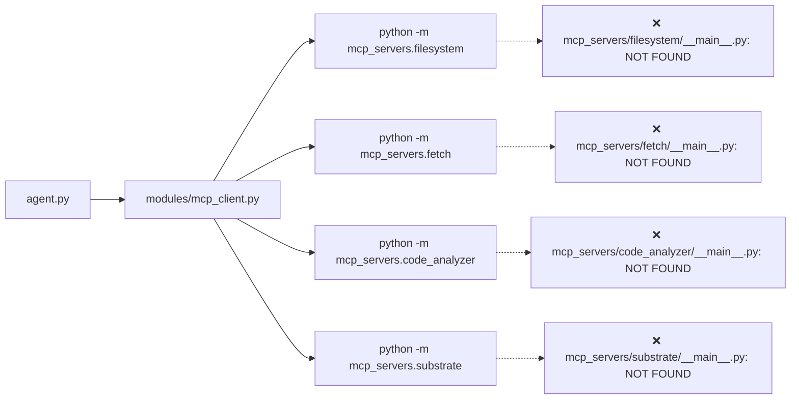

# План: Исправление запуска MCP-серверов

## Проблема

При запуске `agent.py chat` все четыре MCP-сервера падают с ошибкой:

```
No module named mcp_servers.filesystem.__main__; 'mcp_servers.filesystem' is a package and cannot be directly executed
```

## Корневая причина

Конфигурация в [`mcp_servers.json`](../mcp_servers.json:4-8) запускает серверы через `python -m mcp_servers.filesystem`. Механизм `-m` требует внутри пакета файл `__main__.py`. Без него Python отказывается выполнять пакет.

У каждого пакета есть `__init__.py` с функцией `main()` и `if __name__ == "__main__": main()`, но этот блок **не срабатывает** при `-m`. Он работает только при прямом запуске файла (`python mcp_servers/filesystem/__init__.py`).

## Схема запуска



## Исправление

Создать по одному файлу `__main__.py` в каждом пакете-сервере. Каждый файл импортирует `main()` из `__init__.py` и вызывает её.

Все четыре файла идентичны по структуре:

```python
# -*- coding: utf-8 -*-
# mcp_servers/<server>/__main__.py — Точка входа для python -m

from mcp_servers.<server> import main

main()
```

## Затрагиваемые файлы

| Файл | Статус |
|------|--------|
| `mcp_servers/filesystem/__main__.py` | ❌ создать |
| `mcp_servers/fetch/__main__.py` | ❌ создать |
| `mcp_servers/code_analyzer/__main__.py` | ❌ создать |
| `mcp_servers/substrate/__main__.py` | ❌ создать |

## Дополнительно обнаруженные проблемы

1. [`requirements.txt`](../requirements.txt:1-4) **не содержит** `fastmcp`, `mcp`, `tree-sitter`, хотя эти пакеты импортируются на старте ([`modules/mcp_client.py:20`](../modules/mcp_client.py:20) — `from mcp import Client`, [`mcp_servers/filesystem/server.py:10`](../mcp_servers/filesystem/server.py:10) — `from fastmcp import FastMCP`). При чистой установке проект не запустится. Это не блокер текущей задачи, но требует отдельного исправления.

## Проверка

После исправления:
1. `python -m mcp_servers.filesystem` не должен падать с `No module named ... __main__`
2. `python agent.py chat` должен запускаться без ошибок MCP-серверов