# План рефакторинга MCP-серверов

## Цели

1. **Переместить** `mcp_server_filesystem.py` и `mcp_server_fetch.py` в подкаталог `mcp_servers/`
2. **Разбить на модули** — каждый сервер становится sub-package с разделением на `tools.py` + `helpers.py`
3. **Обновить конфигурацию** — `mcp_servers.json`, импорты в тестах, `modules/scaffold.py`, `modules/hot_reload.py`
4. **Обновить документацию** — `plans/wayfinder-mcp/research/fastmcp-guide.md`

---

## Текущее состояние

```
./
├── mcp_server_filesystem.py   # 217 строк, monolithic
├── mcp_server_fetch.py        # 171 строка, monolithic
├── mcp_servers.json           # ссылается на .py в корне
├── modules/
│   ├── mcp_client.py          # MCPManager → читает mcp_servers.json
│   ├── scaffold.py            # create_mcp_server() → пишет в корень
│   └── hot_reload.py          # отслеживает "mcp_server_*" префикс
└── test_core.py               # тесты импортируют из корня
```

---

## Целевая структура

```
mcp_servers/                          # новый подкаталог
├── __init__.py                       # общий экспорт/версия
│
├── filesystem/                       # модульный filesystem-сервер
│   ├── __init__.py                   # mcp + main() — точка входа
│   ├── server.py                     # FastMCP(...) — создаёт инстанс
│   ├── tools.py                      # 6 инструментов с @mcp.tool()
│   └── helpers.py                    # _should_skip_dir()
│
└── fetch/                            # модульный fetch-сервер
    ├── __init__.py                   # mcp + main() — точка входа
    ├── server.py                     # FastMCP(...) — создаёт инстанс
    ├── tools.py                      # 2 инструмента с @mcp.tool()
    └── html_converter.py             # _HTMLStripper → класс HTMLStripper
```

### Принцип модульности (избегаем циклических импортов)

```
__init__.py  ──imports──>  server.py
server.py    ──import     mcp ──>  tools.py (через import в конце server.py)
tools.py     ──import──>  server.py  (берёт mcp)
tools.py     ──import──>  helpers.py / html_converter.py
```

`server.py` сначала определяет `mcp = FastMCP(...)`, потом импортирует `tools.py`, чтобы декораторы `@mcp.tool()` сработали. `tools.py` импортирует `mcp` из `server.py` — это безопасно, т.к. `mcp` уже существует на момент выполнения импорта.

### Запуск (изменение команд)

| Было | Стало |
|------|-------|
| `python mcp_server_filesystem.py` | `python -m mcp_servers.filesystem` |
| `python mcp_server_fetch.py` | `python -m mcp_servers.fetch` |
| `import mcp_server_filesystem` | `from mcp_servers.filesystem.tools import ...` |

---

## Задача 1: Создать `mcp_servers/` и переместить файлы

### 1.1 `mcp_servers/__init__.py`
```python
"""MCP-серверы проекта ai-agent."""
__version__ = "1.0.0"
```

### 1.2 `mcp_servers/filesystem/server.py`
```python
"""FastMCP-инстанс для filesystem-сервера."""
from fastmcp import FastMCP

mcp = FastMCP(
    "filesystem-server",
    instructions="Filesystem operations: read, write, list, search, stat",
    version="1.0.0",
)

# Импортируем tools, чтобы @mcp.tool() сработали
import mcp_servers.filesystem.tools  # noqa: F401
```

### 1.3 `mcp_servers/filesystem/helpers.py`
```python
"""Вспомогательные функции filesystem-сервера."""

def _should_skip_dir(dirname: str) -> bool:
    """Проверить, нужно ли пропустить директорию при обходе."""
    return dirname in ("venv", ".git", "__pycache__", ".pytest_cache", "node_modules")
```

### 1.4 `mcp_servers/filesystem/tools.py`
```python
"""Инструменты filesystem-сервера."""

import os
import re
import fnmatch

from mcp_servers.filesystem.server import mcp
from mcp_servers.filesystem.helpers import _should_skip_dir


@mcp.tool()
def read_file(file_path: str, start_line: int = 1, end_line: int = 0) -> str:
    """Прочитать диапазон строк из файла."""
    # ... код из mcp_server_filesystem.py ...
```

**Перенос:** все 6 инструментов (`read_file`, `write_file`, `list_dir`, `search_files`, `stat_file`, `grep_code`) — без изменений логики.

### 1.5 `mcp_servers/filesystem/__init__.py`
```python
"""Filesystem MCP-сервер (модульная архитектура)."""

import argparse

from mcp_servers.filesystem.server import mcp

# Re-export для тестов
from mcp_servers.filesystem.tools import (  # noqa: F401
    read_file, write_file, list_dir,
    search_files, stat_file, grep_code,
)


def main():
    """Точка входа: парсит аргументы и запускает сервер."""
    parser = argparse.ArgumentParser(description="Filesystem MCP Server")
    parser.add_argument("--transport", choices=["stdio", "sse"], default="stdio")
    parser.add_argument("--port", type=int, default=3100)
    parser.add_argument("--host", default="127.0.0.1")
    args = parser.parse_args()

    if args.transport == "sse":
        mcp.run(transport="sse", host=args.host, port=args.port)
    else:
        mcp.run(transport="stdio")


if __name__ == "__main__":
    main()
```

### 1.6 `mcp_servers/fetch/server.py`
```python
"""FastMCP-инстанс для fetch-сервера."""
from fastmcp import FastMCP

mcp = FastMCP(
    "fetch-server",
    instructions="Web fetch: download URLs, convert HTML to markdown",
    version="1.0.0",
)

import mcp_servers.fetch.tools  # noqa: F401
```

### 1.7 `mcp_servers/fetch/html_converter.py`
```python
"""Конвертер HTML → упрощённый Markdown."""

import html.parser


class HTMLStripper(html.parser.HTMLParser):
    """Простой HTML-to-text конвертер с базовой разметкой."""

    def __init__(self):
        super().__init__()
        self._text = []
        self._skip = False

    def handle_starttag(self, tag, attrs):
        if tag in ("script", "style"):
            self._skip = True
        if tag in ("h1", "h2", "h3", "h4", "h5", "h6"):
            self._text.append("\n## ")
        elif tag == "p":
            self._text.append("\n\n")
        elif tag == "br":
            self._text.append("\n")
        elif tag == "li":
            self._text.append("\n- ")
        elif tag in ("hr", "tr"):
            self._text.append("\n---\n")

    def handle_endtag(self, tag):
        if tag in ("script", "style"):
            self._skip = False

    def handle_data(self, data):
        if not self._skip:
            self._text.append(data)

    def get_text(self):
        return "".join(self._text)
```

### 1.8 `mcp_servers/fetch/tools.py`
```python
"""Инструменты fetch-сервера."""

import urllib.request
import urllib.error

from mcp_servers.fetch.server import mcp
from mcp_servers.fetch.html_converter import HTMLStripper


@mcp.tool()
def fetch_url(url: str, timeout: int = 30) -> str:
    """Загрузить содержимое URL."""
    # ... код из mcp_server_fetch.py ...


@mcp.tool()
def fetch_markdown(url: str, timeout: int = 30) -> str:
    """Загрузить URL и конвертировать HTML в Markdown."""
    # ... код из mcp_server_fetch.py ...
```

### 1.9 `mcp_servers/fetch/__init__.py`
```python
"""Web Fetch MCP-сервер (модульная архитектура)."""

import argparse

from mcp_servers.fetch.server import mcp
from mcp_servers.fetch.tools import fetch_url, fetch_markdown  # noqa: F401


def main():
    """Точка входа: парсит аргументы и запускает сервер."""
    parser = argparse.ArgumentParser(description="Web Fetch MCP Server")
    parser.add_argument("--transport", choices=["stdio", "sse"], default="stdio")
    parser.add_argument("--port", type=int, default=3200)
    parser.add_argument("--host", default="127.0.0.1")
    args = parser.parse_args()

    if args.transport == "sse":
        mcp.run(transport="sse", host=args.host, port=args.port)
    else:
        mcp.run(transport="stdio")


if __name__ == "__main__":
    main()
```

---

## Задача 2: Обновить `mcp_servers.json`

```json
{
  "servers": {
    "filesystem": {
      "transport": "stdio",
      "command": "python",
      "args": ["-m", "mcp_servers.filesystem"],
      "description": "Filesystem operations (read, write, list, search, stat)",
      "timeout": 30
    },
    "fetch": {
      "transport": "stdio",
      "command": "python",
      "args": ["-m", "mcp_servers.fetch"],
      "description": "Web fetch and HTML-to-markdown conversion",
      "timeout": 30
    }
  }
}
```

---

## Задача 3: Обновить `modules/scaffold.py`

### 3.1 `create_mcp_server()` — новый путь

```python
filepath = os.path.join(self.repo_path, "mcp_servers", filename)
```

### 3.2 `_mcp_server_template()` — обновлённый шаблон

```python
def _mcp_server_template(self, name: str, description: str) -> str:
    return f'''# -*- coding: utf-8 -*-
# mcp_servers/{name}/ — MCP-сервер: {description or name}
#
# Запуск:
#     python -m mcp_servers.{name}
#     python -m mcp_servers.{name} --transport sse --port 3300

...
```

Шаблон должен генерировать modular-структуру: `server.py` + `tools.py` вместо монолитного файла.

### 3.3 `_create_mcp_test()` — обновлённый импорт

```python
test_code = f'''
    def test_mcp_{name}_ping(self):
        """MCP-сервер {name} отвечает на ping."""
        from mcp_servers.{name}.tools import ping
        result = ping()
        self.assertEqual(result, "pong")
'''
```

---

## Задача 4: Обновить `modules/hot_reload.py`

В функции классификации зон мутабельности (строка 178):

```python
autonomous_prefixes = [
    "core_tools.py", "agents/", "modules/", "prompts/",
    "prompts.json", "mcp_server_", "mcp_servers/",
]
```

---

## Задача 5: Обновить тесты в `test_core.py`

Все импорты вида:
- `from mcp_server_filesystem import ...` → `from mcp_servers.filesystem.tools import ...`
- `from mcp_server_fetch import ...` → `from mcp_servers.fetch.tools import ...`

Затрагивает классы:
- `TestMCPServerFilesystem` (8 тестов)
- `TestMCPServerFetch` (2 теста)

---

## Задача 6: Обновить документацию `fastmcp-guide.md`

Обновить:
1. Раздел **Структура проекта** — пути с `mcp_server_<name>.py` → `mcp_servers/<name>/`
2. Раздел **Тестирование локально** — импорты
3. Раздел **Best practices** — ссылка на modular-архитектуру

Добавить:
- Правило: «Каждый сервер — отдельный sub-package внутри `mcp_servers/»**
- Правило: «Структура модуля: `server.py` (FastMCP), `tools.py` (инструменты), `helpers.py` / `<специализированный>.py` (утилиты)»

---

## Диаграмма: поток импортов

```mermaid
flowchart TD
    subgraph mcp_servers/filesystem/
        __init___fs["__init__.py<br/>main() + re-export tools"]
        server_fs["server.py<br/>mcp = FastMCP()"]
        tools_fs["tools.py<br/>@mcp.tool()"]
        helpers_fs["helpers.py<br/>_should_skip_dir()"]
    end

    subgraph mcp_servers/fetch/
        __init___fetch["__init__.py<br/>main() + re-export tools"]
        server_fetch["server.py<br/>mcp = FastMCP()"]
        tools_fetch["tools.py<br/>@mcp.tool()"]
        html_conv["html_converter.py<br/>HTMLStripper"]
    end

    %% Filesystem flow
    __init___fs -->|imports| server_fs
    server_fs -->|defines mcp then imports| tools_fs
    tools_fs -->|imports mcp + helpers| server_fs
    tools_fs -->|imports| helpers_fs

    %% Fetch flow
    __init___fetch -->|imports| server_fetch
    server_fetch -->|defines mcp then imports| tools_fetch
    tools_fetch -->|imports| server_fetch
    tools_fetch -->|imports| html_conv

    %% External consumers
    mcp_servers_json["mcp_servers.json<br/>-m mcp_servers.filesystem"]
    test_core["test_core.py<br/>from mcp_servers.filesystem.tools"]
```



---

## Диаграмма: порядок выполнения задач


---

## Риски и замечания

| Риск | Описание | Mitigation |
|------|----------|------------|
| **Циклические импорты** | `tools.py ←→ server.py` | `mcp` определяется до импорта `tools.py` — Python-safe |
| **Поломка тестов** | Импорты из корня перестанут работать | Одновременно обновить тесты в Задаче 5 |
| **Поломка MCPManager** | Он читает `mcp_servers.json` и запускает серверы | Пути в json меняются на `-m mcp_servers.*` |
| **Старые файлы в корне** | Останутся `mcp_server_filesystem.py` и `mcp_server_fetch.py` | **Удалить** после проверки, что всё работает |
| **Scaffold для новых серверов** | Создаёт монолит в корне | Обновить шаблон на modular-структуру |

**После выполнения всех задач — удалить старые файлы** `mcp_server_filesystem.py` и `mcp_server_fetch.py` из корня проекта.