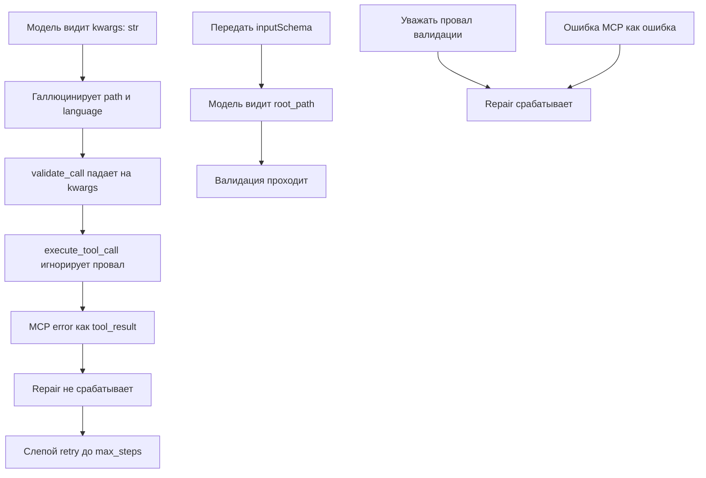

# План: устранение зацикливания агента на MCP-инструментах

> **Дата:** 2026-10-27
> **Симптом:** `CasualAgent` на запрос «изучи проект в каталоге /home/giv/www/ai-agent/ и сделай его описание» 14 раз подряд вызывает `code_analyzer__scan_project` с мусорными аргументами и упирается в `max_steps`.
> **Метод:** статическое чтение кода (архитектурный режим, код не исполнялся).

---

## 1. Наблюдаемое поведение

Из лога сессии:

| Шаг | Аргументы вызова | Что не так |
|-----|------------------|------------|
| 1 | `{'path': '/home/giv/www/ai-agent/', 'language': 'all'}` | нет `root_path`; `language='all'` не существует |
| 2 | `{'kwargs': '<arg name="root_path">/home/giv/www/a...nt/</arg>...'}` | весь XML-блоб попал в единственный параметр `kwargs` |
| 3–14 | `/path/to/your/project`, `/путь/к/проекту`, `/путь/к/вашему/проекту` | галлюцинация placeholder-путей |

Модель не «глупая» — она не получила ни корректной схемы инструмента, ни внятной ошибки.

---

## 2. Корневые причины

### RC-1. MCP-обёртка рекламирует неверную схему (главная)

- [`modules/mcp_client.py:167-171`](../modules/mcp_client.py:167) — обёртка регистрируется как `def _wrapper(**kwargs: Any) -> str`.
- [`core/core_tools.py:46-73`](../core/core_tools.py:46) — `_func_to_schema` строит схему из type hints. Для `**kwargs: Any` получается единственный параметр `kwargs` (тип `Any` → `{}` → в `list_tools` рендерится как `str`).
- [`core/core_tools.py:271-282`](../core/core_tools.py:271) — `list_tools()` вставляет эту схему в системный промпт.
- [`modules/mcp_client.py:282-301`](../modules/mcp_client.py:282) — `_register_tools` **игнорирует** `tool.inputSchema`, приходящий от MCP-сервера.

**Итог:** модель видит `code_analyzer__scan_project(kwargs: str)` и не знает про `root_path`/`language`.

### RC-2. Валидация всегда падает, но игнорируется

- `_func_to_schema` помечает `**kwargs` как обязательный (`param.default is inspect.Parameter.empty`), поэтому `validate_call` всегда возвращает `missing=["kwargs"]`.
- [`core/core.py:154-156`](../core/core.py:154) — `if not is_valid and kwargs: pass` (дефект Q-2 из [`quality-review-20261027.md`](quality-review-20261027.md:102)). Вызов уходит с неверными kwargs.
- Позиционный парсер [`core/core_tools.py:126-139`](../core/core_tools.py:126) кладёт весь XML-блоб в `param_names[0]` = `kwargs` — ровно то, что видно на шаге 2.

### RC-3. Ошибка MCP маскируется под успех

- [`modules/mcp_client.py:143-145`](../modules/mcp_client.py:143) — при сбое возвращается строка `MCP error: ...`.
- [`core/core.py:161`](../core/core.py:161) — любой результат оборачивается в `<tool_result>`, поэтому repair-цикл [`core/core.py:87-123`](../core/core.py:87) не срабатывает.
- [`core/core.py:81-84`](../core/core.py:81) — ReAct не накапливает историю (Q-4), модель не видит прошлых провалов и повторяет попытки вслепую.

### RC-4. Вторичное: галлюцинация путей

Следствие RC-1…RC-3. Отдельного фикса не требует — уйдёт после исправления схемы и ошибок.

---

## 3. Feedback loop (красный тест)

Шов: `_register_tools` / `_register_mcp_tool` с фейковым MCP-клиентом, отдающим `Tool` с реальным `inputSchema`.

```python
# tests/test_mcp_manager.py
def test_mcp_tool_schema_from_input_schema(self):
    from modules.mcp_client import _register_mcp_tool, MCPServerConfig
    from core.core_tools import _GLOBAL_REGISTRY
    schema = {
        "type": "object",
        "properties": {"root_path": {"type": "string"},
                       "language": {"type": "string"}},
        "required": ["root_path"],
    }
    _register_mcp_tool(
        "fake__scan", MCPServerConfig("fake", {"transport": "stdio"}),
        "scan", "desc", parameters=schema,
    )
    assert "root_path" in _GLOBAL_REGISTRY.list_tools()
    assert _GLOBAL_REGISTRY.get_schema("fake__scan")["required"] == ["root_path"]
```

Сейчас тест красный (в `list_tools` будет `kwargs: str`), после фикса — зелёный.

Дополнительный тест на RC-2/RC-3:

```python
def test_execute_tool_call_rejects_invalid_args(self):
    from core.core import ReActEngine
    engine = ReActEngine(max_steps=3)
    found, result = engine.execute_tool_call(
        '<call name="code_analyzer__scan_project">path="/tmp"</call>')
    assert found
    assert not result.strip().startswith("<tool_result")  # ошибка → repair
```

---

## 4. Диаграмма



---

## 5. Шаги исправления

| # | Файл | Правка |
|---|------|--------|
| 1 | [`core/core_tools.py:208`](../core/core_tools.py:208) | `ToolRegistry.register(..., parameters: Optional[dict] = None)` — явная схема приоритетнее автогенерации |
| 2 | [`core/core_tools.py:57-67`](../core/core_tools.py:57) | `_func_to_schema` пропускает `VAR_KEYWORD`/`VAR_POSITIONAL`, не делает их required |
| 3 | [`modules/mcp_client.py:158-173`](../modules/mcp_client.py:158) | `_register_mcp_tool(..., parameters=None)` прокидывает схему в реестр |
| 4 | [`modules/mcp_client.py:288-298`](../modules/mcp_client.py:288) | `_register_tools` передаёт `tool.inputSchema` |
| 5 | [`core/core.py:154-156`](../core/core.py:154) | При провале валидации возвращать ошибку (запускает repair), а не `pass` |
| 6 | [`modules/mcp_client.py:143-145`](../modules/mcp_client.py:143) | Ошибка MCP отличима от успеха (маркер/исключение) |
| 7 | [`core/core.py:56-85`](../core/core.py:56) | ReAct накапливает историю сообщений (Q-4) |

---

## 5a. Разрыв в трейсинге (отдельная проблема)

**Симптом:** в `traces/session_*/trace.jsonl` нет ни одного `tool_call`/`tool_result` — видно только `llm_call` (обрезанный системный промпт) и `final`. Диагностировать зацикливание по трейсу невозможно.

### RC-5. ReActEngine не пишет в трейс

- [`core/core.py:28-163`](../core/core.py:28) — `ReActEngine` не принимает `tracer`; вызовы инструментов, их аргументы и ошибки идут только в `console.print` ([`core/core.py:151`](../core/core.py:151)).
- [`agents/casual_agent.py:52-58`](../agents/casual_agent.py:52) — логируются только `log_llm_call` и `log_final`; `log_tool_call`/`log_tool_result` не вызываются.
- [`modules/tracer.py:112-117`](../modules/tracer.py:112) — метод `log_tool_call` есть, но из ReAct-цикла не используется.
- Обрезка `[:500]` ([`agents/casual_agent.py:53`](../agents/casual_agent.py:53)) теряет аргументы и результаты.

### Шаги исправления трейсинга

| # | Файл | Правка |
|---|------|--------|
| 8 | [`core/core.py:42-47`](../core/core.py:42) | `ReActEngine.__init__(..., tracer=None)`; `BaseAgent` прокидывает tracer |
| 9 | [`core/core.py:69-163`](../core/core.py:69) | На каждом шаге писать `llm_call` (полный ответ), `tool_call` (имя + kwargs), `tool_result` (результат/ошибка) |
| 10 | [`agents/casual_agent.py:36-58`](../agents/casual_agent.py:36) | Передавать tracer в `BaseAgent`/`ReActEngine`; убрать обрезку `[:500]` |
| 11 | [`modules/tracer.py:112-117`](../modules/tracer.py:112) | `log_tool_call` дополнить полями `args`, `error`, `duration_ms` |

### Критерий для трейсинга

- [x] После сценария «изучи проект…» в `trace.jsonl` есть записи `tool_call` с `root_path` и `tool_result` с ошибкой/данными для каждого шага.

---

## 6. Критерии готовности

- [x] Красный тест из §3 написан и падает до фикса.
- [x] После фикса `list_tools()` показывает `code_analyzer__scan_project(root_path: str, language: str)`.
- [x] `execute_tool_call` с невалидными аргументами возвращает ошибку, а не `<tool_result>`.
- [x] Сценарий «изучи проект в каталоге /home/giv/www/ai-agent/» завершается за 1–2 шага с реальным результатом `scan_project`.
- [x] Все существующие тесты (`tests/`) зелёные (314 OK).

---

## 6a. Дефекты, найденные при проверке (сверх плана)

### RC-6. Поле схемы называется `input_schema`, а не `inputSchema`

В установленном `mcp` SDK (pydantic-модель `Tool`) атрибут — `input_schema`.
`getattr(tool, "inputSchema", None)` молча возвращал `None`, поэтому даже после
прокидывания `parameters` схема оставалась пустой (`{"properties": {}, "required": []}`).

**Фикс:** [`modules/mcp_client.py:305-320`](../modules/mcp_client.py:305) — читать
`input_schema` с фолбэком на `inputSchema`.

### RC-7. MCP-серверы запускались системным `python` (2.7)

[`mcp_servers.json`](../mcp_servers.json:5) задаёт `"command": "python"`, что в этом
окружении резолвится в `/usr/bin/python` (Python 2.7) → `No module named fastmcp`,
0 подключённых серверов, ни одного MCP-инструмента в реестре.

**Фикс:** [`modules/mcp_client.py:58-68`](../modules/mcp_client.py:58) — `_resolve_command()`
подставляет `venv/bin/python` (или `sys.executable`) при подключении, не меняя
декларативный конфиг.

### RC-8. Тест `test_mcp_server_config_defaults` проверял неверный контракт

Тест ждал `config.env == {}`, но `env` по docstring — это `os.environ` + переопределения.
**Фикс:** проверять `config._env` (сырые переопределения).

---

## 7. Связанные дефекты из обзора

- Q-2 (валидация игнорируется) — [`quality-review-20261027.md:102`](quality-review-20261027.md:102)
- Q-4 (нет истории ReAct) — [`quality-review-20261027.md:104`](quality-review-20261027.md:104)
- Q-5 (парсер берёт только первый `<call>`) — [`quality-review-20261027.md:105`](quality-review-20261027.md:105)
