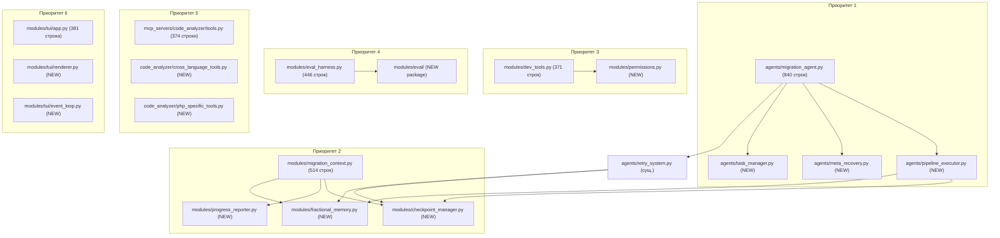

# План модульного рефакторинга

## 1. Сводка метрик

### Крупнейшие файлы проекта (по количеству строк)

| № | Файл | Строк | Классов | Функций | Статус |
|---|------|-------|---------|---------|--------|
| 1 | `agents/migration_agent.py` | **~840** | 1 (MigrationAgent) | ~15 методов | ⚠️ КРИТИЧЕСКИЙ |
| 2 | `modules/migration_context.py` | **514** | 3 (CheckpointManager, ProgressReporter, FractionalMemory) | 1 | ⚠️ КРУПНЫЙ |
| 3 | `modules/eval_harness.py` | **446** | 3 (EvalCase, EvalResult, EvalRunner, EvalReporter) | 2 | ⚠️ КРУПНЫЙ |
| 4 | `modules/tui/integration_example.py` | ~440 | 1 (MockMigrationAgent) | ~15 функций | ⚠️ ДЕМО |
| 5 | `modules/tui/app.py` | **381** | 1 (TUIApp) | ~10 методов | ⚠️ КРУПНЫЙ |
| 6 | `mcp_servers/code_analyzer/tools.py` | **374** | 0 (все функции) | 8 инструментов | ⚠️ КРУПНЫЙ |
| 7 | `modules/dev_tools.py` | **371** | 0 | 7 инструментов + 3 утилиты | ⚠️ КРУПНЫЙ |
| 8 | `modules/scaffold.py` | **347** | 2 (ScaffoldError, Scaffold) | ~5 | КРУПНЫЙ |
| 9 | `modules/repo_map.py` | **321** | 0 | 4 функции | СРЕДНИЙ |
| 10 | `modules/retrospective.py` | **311** | 2 (Retrospective, RetroReport) | ~8 | СРЕДНИЙ |
| 11 | `core/core_tools.py` | **311** | 1 (ToolRegistry) | 4 функции | IMMUTABLE |
| 12 | `modules/dependency_planner.py` | **305** | 1 (DependencyPlanner) | 1 функция | СРЕДНИЙ |
| 13 | `modules/mcp_client.py` | **306** | 2 (MCPServerConfig, MCPManager) | 6 функций | СРЕДНИЙ |
| 14 | `modules/llm/adapter.py` | ~280 | 1 (OllamaAdapter) | 4 функции | СРЕДНИЙ |
| 15 | `mcp_servers/code_analyzer/cross_language/php_js_bridge.py` | ~260 | 0 | 6 функций | СРЕДНИЙ |
| 16 | `modules/gate.py` | **265** | 2 (GateError, Gate) | ~8 | СРЕДНИЙ |
| 17 | `modules/tui/examples_api.py` | ~400 | 1 | ~12 функций | ⚠️ ДЕМО |
| 18 | `modules/hot_reload.py` | **219** | 0 | 8 функций | СРЕДНИЙ |
| 19 | `mcp_servers/code_analyzer/languages/php/procedural.py` | ~200 | 0 | 2 функции | СРЕДНИЙ |
| 20 | `modules/sandbox.py` | **197** | 2 (SandboxError, Sandbox) | ~6 | СРЕДНИЙ |

### Легенда зон мутабельности (из ADR-001)
- **autonomous** — можно менять без подтверждения
- **supervised** — требуется подтверждение человека
- **kernel** — только человек

---

## 2. Анализ глубины модулей (согласно принципам codebase-design)

### 2.1. `agents/migration_agent.py` — МЕЛКИЙ МОДУЛЬ ⛔

**Проблема:** Один класс с ~15 публичными методами — **shallow module**. Интерфейс огромен, реализация плоская в одном файле.

**Симптомы:**
- `_execute_single_task()` и `_execute_task_pipeline()` — 90% дублирования кода
- `_execute_single_task_async()` оборачивает `_execute_task_pipeline()` — дублирование логики
- `_meta_recovery()` — самостоятельная логика, не связанная с MigrationAgent как агентом
- Тесты вынуждены знать про внутренние методы → интерфейс не является тестовой поверхностью

**Требование глубины:** `MigrationAgent` должен иметь малый интерфейс (run(), generate_plan()) — всё остальное уходит в подмодули.

### 2.2. `modules/migration_context.py` — НАРУШЕНИЕ SRP ⛔

**Проблема:** Три не связанных между собой класса в одном файле:
- `CheckpointManager` — постоянство/восстановление
- `ProgressReporter` — отчёты
- `FractionalMemory` — интеграция с дробно-слойной памятью
- `generate_migration_report()` — отдельная функция

### 2.3. `modules/dev_tools.py` — СМЕШЕНИЕ ОТВЕТСТВЕННОСТЕЙ ⛔

**Проблема:** Система разрешений + регистрация инструментов + git-команды — в одном файле. Система разрешений — свой отдельный модуль.

### 2.4. `modules/eval_harness.py` — CLI + DATA + LOGIC ⛔

**Проблема:** `@dataclass EvalCase/EvalResult`, `EvalRunner`, `EvalReporter`, `main()` — 4 ответственности в одном файле.

### 2.5. `mcp_servers/code_analyzer/tools.py` — ПЛОСКАЯ СТРУКТУРА ⛔

8 инструментов в одном файле, 374 строки. Инструменты разной природы: сканирование, функции, перекрёстные ссылки, PHP→JS — всё в одной куче.

### 2.6. `modules/tui/app.py` — TUIApp толстый ⚠️

381 строка с TUIApp + event loop. Основной кандидат — выделить event loop и рендеринг в отдельные модули.

---

## 3. План рефакторинга

### Приоритет 1: Декомпозиция `agents/migration_agent.py` (САМЫЙ ВАЖНЫЙ)

**Цель:** Разбить 840-строчный файл на 5 модулей.

**Схема:**

```
agents/
├── migration_agent.py         # Facade: только run() + generate_plan()
├── pipeline_executor.py       # ExecuteTaskPipeline – SDD → TDD → Coding → Critic (новое)
├── meta_recovery.py           # MetaOptimizer – диагностика и восстановление (из _meta_recovery)
├── task_manager.py            # Управление tasks.json + shared_context (из утилит)
└── retry_system.py            # (уже существует – оставить)
```

**Interface (MigrationAgent после рефакторинга):**
```python
class MigrationAgent(BaseAgent):
    def run()                                                    # точка входа
    def generate_plan() -> bool                                  # генерация плана
```
Всё остальное — private delegation.

**Seam:** `PipelineExecutor` — интерфейс на 1 метод: `async execute_task(task) -> tuple[bool, str]`.

**Тесты:** Проверяем `MigrationAgent.run()` через stub PipelineExecutor.

**Риски:**
- `_execute_single_task()` и `_execute_task_pipeline()` — дубли. Решение: удалить синхронную версию, оставить только async.
- `_log_checkpoint_and_memory()` инлайновый — перенести в `task_manager.py`.

---

### Приоритет 2: Декомпозиция `modules/migration_context.py`

**Цель:** Разбить 514 строк на 3 независимых модуля.

```
modules/
├── checkpoint_manager.py      # CheckpointManager (из migration_context)
├── progress_reporter.py       # ProgressReporter + generate_migration_report
├── fractional_memory.py       # FractionalMemory
├── migration_context.py       # удалить (ушел на 3 модуля)
```

**Interface каждого:** один класс, 3-6 методов.

**Seam:** Интерфейс `CheckpointManager` уже чистый. `ProgressReporter` — чистый. `FractionalMemory` — чистый.

**Риски:** Нужно обновить импорты во всех файлах, использующих `from modules.migration_context import ...`.

---

### Приоритет 3: Декомпозиция `modules/dev_tools.py`

**Цель:** Выделить систему разрешений в отдельный модуль.

```
modules/
├── dev_tools.py               # Только инструменты (@register_tool)
├── permissions.py             # PermissionSystem (set_permission_level, get_permission_level, _confirm_action)
```

**Interface:** `permissions.py` экспортирует 3 функции. `dev_tools.py` только их импортирует.

**Seam:** Функции разрешений — независимый слой.

---

### Приоритет 4: Декомпозиция `modules/eval_harness.py`

**Цель:** Разделить данные, runner, reporter, CLI.

```
modules/eval/
├── __init__.py                # Публичные экспорты
├── cases.py                   # EvalCase, GOLDEN_CASES
├── runner.py                  # EvalRunner
├── reporter.py                # EvalReporter, ModelReport, EvalResult
├── cli.py                     # main()
├── eval_harness.py            # удалить
```

**Interface:** `EvalRunner.run()` возвращает список `EvalResult`, `EvalReporter.format_report()`.

**Seam:** Чистый. Runner не знает про reporter, reporter не знает про CLI.

---

### Приоритет 5: Декомпозиция `mcp_servers/code_analyzer/tools.py`

**Цель:** Группировать инструменты по назначению.

```
mcp_servers/code_analyzer/
├── tools.py                   # Инструменты общего назначения (scan_project, query_function)
├── cross_language_tools.py    # query_cross_references, query_js_from_php, scan_php_js_project
├── php_specific_tools.py      # scan_procedural_php
```

**Interface:** Каждый файл регистрирует свои инструменты через `@mcp.tool()`. `server.py` импортирует все три.

**Seam:** Никакой — просто группировка. Инструменты независимы.

---

### Приоритет 6: Декомпозиция `modules/tui/app.py`

**Цель:** Выделить рендеринг и event loop.

```
modules/tui/
├── app.py                     # TUIApp (facade)
├── renderer.py                # Цикл рендеринга (отделить от логики приложения)
├── event_loop.py              # Event loop + обработка ввода (из app.py)
├── components.py              # (уже существует — не трогать)
```

**Interface:** `TUIApp.run(agent, tracer)` — только точка входа.

**Seam:** `renderer.py` абстрагирует `curses.wrapper` / `rich.layout`.

---

### Приоритет 7: Очистка `modules/tui/examples_api.py` и `integration_example.py`

Примеры — это **не production code**. Их дублирование (2 файла с одной логикой) создаёт иллюзию жирности.

**Решение:** Удалить дублирующиеся примеры, оставить один файл интеграционных примеров или вынести в `docs/examples/`.

---

## 4. Граф зависимостей для рефакторинга



---

## 5. Порядок выполнения

| Шаг | Описание | Затрагивает файлов | CI-безопасно? |
|-----|----------|-------------------|---------------|
| 0 | Создать файл `AGENTS.md` с архитектурной картой | 1 | Да |
| 1 | **Приоритет 2** — migration_context → 3 файла (иммутабельный рефакторинг: только split) | 3 new + обновить 5 импортов | ✅ Тесты проходят без изменений |
| 2 | **Приоритет 3** — dev_tools → permissions.py (чистый split) | 1 new + обновить 1 файл | ✅ |
| 3 | **Приоритет 4** — eval_harness → пакет eval/ | 4 new + 1 удалить + обновить импорты | ✅ (тесты не зависят) |
| 4 | **Приоритет 5** — code_analyzer/tools → 3 файла | 2 new + 1 изменить | ✅ |
| 5 | **Приоритет 7** — очистка tui/examples | Удалить 1 файл, слить в 1 | ✅ |
| 6 | **Приоритет 6** — tui/app → renderer + event_loop | 2 new + изменить 1 | ⚠️ Нужно тестировать визуально |
| 7 | **Приоритет 1** — migration_agent → 4 файла (самое сложное) | 3 new + изменить 1 | ⚠️ Нужна тщательная проверка |

---

## 6. Оценка эффекта

### После рефакторинга

| Модуль | Сейчас | После | Уменьшение |
|--------|--------|-------|------------|
| `agents/migration_agent.py` | 840 | ~120 | -86% |
| `modules/migration_context.py` | 514 | **удалён** (→3 файла) | 100% |
| `modules/eval_harness.py` | 446 | **удалён** (→ пакет) | 100% |
| `modules/dev_tools.py` | 371 | ~270 | -27% |
| `mcp_servers/code_analyzer/tools.py` | 374 | ~120 | -68% |
| `modules/tui/app.py` | 381 | ~150 | -61% |

### Ключевые метрики качества

- **Максимальная глубина**: Файлы >500 строк исчезнут (сейчас 2 таких файла)
- **Средукция дублирования**: `_execute_single_task()` и `_ execute_single_task_async()` перестанут дублироваться
- **Тестовая поверхность**: Появится `PipelineExecutor` как интерфейс для тестирования конвейера
- **Leverage**: 20 call site'ов одного интерфейса PipelineExecutor вместо 15 методов MigrationAgent

---

## 7. Иммутабельные файлы (НЕ ТРОГАТЬ)

- `_core.py` — kernel
- `core/core.py` — supervised
- `core/core_tools.py` — supervised
- `core/__init__.py` — supervised

---

## 8. Дорожная карта

```mermaid
gantt
    title План модульного рефакторинга
    dateFormat  YYYY-MM-DD
    section Приоритет 2
    migration_context → 3 файла      :a1, 1d
    section Приоритет 3
    dev_tools → permissions          :a2, 0.5d
    section Приоритет 4
    eval_harness → eval/ пакет       :a3, 1d
    section Приоритет 5
    code_analyzer tools → 3 файла    :a4, 0.5d
    section Приоритет 7
    Очистка tui/examples             :a5, 0.5d
    section Приоритет 6
    tui/app → renderer + event_loop  :a6, 1.5d
    section Приоритет 1
    migration_agent → 4 файла       :a7, 3d