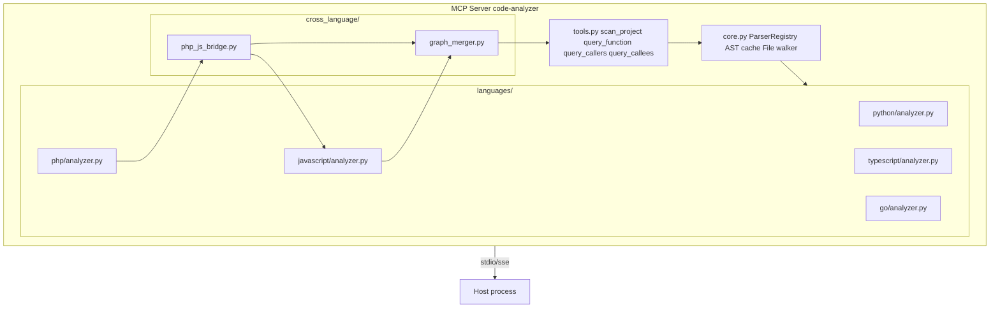
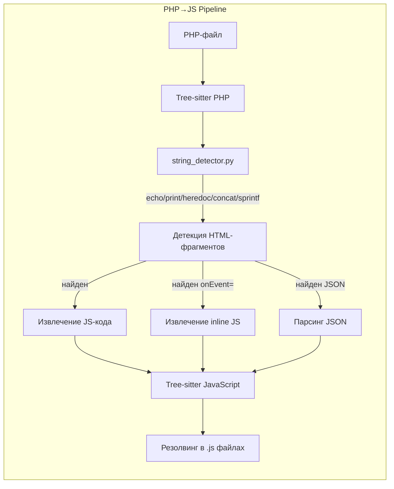

# План: Мультиязычный статический анализатор (code_analyzer)

## Решение

**Единый MCP-сервер `code-analyzer`** с языковыми модулями (Python, PHP, JS, TS, Go) и cross-language pipeline PHP→HTML→JS.

**ADR:** [ADR-002](../docs/adr/ADR-002-multi-language-analyzer.md)

---

## Архитектура





---

## План реализации (поэтапно)

### Фаза 1: Рефакторинг существующего Python-модуля

**Цель:** Выделить `BaseAnalyzer`, `core.py` и `languages/python/` без изменения поведения.

| # | Задача | Файлы | Описание |
|---|--------|-------|----------|
| 1.1 | Создать `core.py` | `mcp_servers/code_analyzer/core.py` | Перенести: `_parse_file`, `_get_text`, `_get_all_files`, `_clear_cache`, `_ast_cache`. Единая точка входа для работы с файлами и кэшем. |
| 1.2 | Создать `languages/base.py` | `mcp_servers/code_analyzer/languages/__init__.py`, `languages/base.py` | `AbstractAnalyzer` с методами `collect_definitions`, `get_symbol_signature`, `build_call_graph`, `language` property, `parser` property. `ParserRegistry` — реестр анализаторов. |
| 1.3 | Создать `languages/python/analyzer.py` | `mcp_servers/code_analyzer/languages/python/analyzer.py` | `PythonAnalyzer(BaseAnalyzer)`. Перенести всю Python-специфичную логику из tools.py. |
| 1.4 | Переписать `tools.py` | `mcp_servers/code_analyzer/tools.py` | Инструменты получают `language: str | None`, диспатчат через `ParserRegistry.get(language)`. Логика одинаковая для всех языков. |
| 1.5 | Обновить тесты | `tests/test_mcp_code_analyzer.py` | Проверить, что старые тесты проходят через новый `tools.py`. |

### Фаза 2: PHP-модуль

**Цель:** Анализ PHP-файлов: функции, классы, вызовы, граф. Подготовка string_detector.

| # | Задача | Файлы | Описание |
|---|--------|-------|----------|
| 2.1 | Установить `tree-sitter-php` | `pyproject.toml` / `requirements.txt` | Добавить зависимость. Проверить совместимость с версией tree-sitter. |
| 2.2 | Создать `languages/php/analyzer.py` | `mcp_servers/code_analyzer/languages/php/analyzer.py` | `PhpAnalyzer(BaseAnalyzer)`. Маппинг AST-нод: `function_definition` → `function_definition`, `class_definition` → `class_definition`, `call` → `function_call_expression`. |
| 2.3 | Создать `string_detector.py` | `mcp_servers/code_analyzer/languages/php/string_detector.py` | Извлекает все строковые литералы из PHP-файла. Классифицирует: plain string, echo-выражение, heredoc, конкатенация. |
| 2.4 | Тесты PHP | `tests/test_mcp_code_analyzer.py` (или отдельный файл) | Тест: `scan_project` на PHP-проекте, `query_function` для PHP-функций. |

### Фаза 3: JavaScript / TypeScript модули

**Цель:** Анализ JS/TS-файлов. Зависимость для PHP→JS bridge.

| # | Задача | Файлы | Описание |
|---|--------|-------|----------|
| 3.1 | Установить `tree-sitter-javascript`, `tree-sitter-typescript` | `pyproject.toml` | Добавить зависимости. |
| 3.2 | Создать `languages/javascript/analyzer.py` | `mcp_servers/code_analyzer/languages/javascript/analyzer.py` | `JavaScriptAnalyzer(BaseAnalyzer)`. Маппинг: `function_declaration` → function, `class_declaration` → class, `call_expression` → call. |
| 3.3 | Создать `languages/typescript/analyzer.py` | `mcp_servers/code_analyzer/languages/typescript/analyzer.py` | `TypeScriptAnalyzer(BaseAnalyzer)`. JS + TS-specific ноды (interface, type_alias). |
| 3.4 | Тесты JS/TS | `tests/` | Тест: `scan_project` на JS/TS-проекте, `query_function`. |

### Фаза 4: Go-модуль

**Цель:** Анализ Go-файлов. Изолированный модуль, без cross-language.

| # | Задача | Файлы | Описание |
|---|--------|-------|----------|
| 4.1 | Установить `tree-sitter-go` | `pyproject.toml` | Добавить зависимость. |
| 4.2 | Создать `languages/go/analyzer.py` | `mcp_servers/code_analyzer/languages/go/analyzer.py` | `GoAnalyzer(BaseAnalyzer)`. Маппинг: `function_declaration` → function, `method_declaration` → method, `call_expression` → call. |
| 4.3 | Тесты Go | `tests/` | Тест: `scan_project` на Go-проекте. |

### Фаза 5: PHP→JS Bridge

**Цель:** Cross-language анализ: PHP-строки → HTML → JS → резолвинг в `.js`-файлах.

| # | Задача | Файлы | Описание |
|---|--------|-------|----------|
| 5.1 | Создать `cross_language/php_js_bridge.py` | `mcp_servers/code_analyzer/cross_language/php_js_bridge.py` | Функция `extract_js_from_php(php_ast)`: обходит PHP-строки → HTML-детект → извлечение JS-фрагментов. |
| 5.2 | Интеграция с JavaScriptAnalyzer | `mcp_servers/code_analyzer/cross_language/php_js_bridge.py` | Передаёт JS-фрагменты в `JavaScriptAnalyzer` для изолированного парсинга. Возвращает найденные символы. |
| 5.3 | Создать `cross_language/graph_merger.py` | `mcp_servers/code_analyzer/cross_language/graph_merger.py` | Сливает PHP-граф с JS-символами. Добавляет мета-информацию: `source_file` (PHP), `generated_js_file` (если выяснено), `js_symbols`. |
| 5.4 | Создать `query_cross_references` | `mcp_servers/code_analyzer/tools.py` | Новый MCP-инструмент: поиск символа во всех языках проекта, включая PHP→JS bridge. |
| 5.5 | Тесты bridge | `tests/` | PHP-файл с `echo "<script>greet()</script>"` → проверка, что `greet` резолвится в .js-файле. |

### Фаза 6: Интеграция и деплой

**Цель:** Обновить `mcp_servers.json`, настроить запуск, проверить регрессию.

| # | Задача | Файлы | Описание |
|---|--------|-------|----------|
| 6.1 | Обновить `mcp_servers.json` | `mcp_servers.json` | Увеличить timeout (tree-sitter на big projects). |
| 6.2 | Регрессионные тесты | `tests/test_mcp_code_analyzer.py` | Запустить все тесты — Python не должен сломаться. |
| 6.3 | Документация | `docs/code_analyzer/` | Описать все инструменты, языки, примеры для PHP→JS bridge. |

---

## Зависимости (requirements.txt / pyproject.toml)

Текущие:
```
tree-sitter>=0.23.0
tree-sitter-python>=0.23.0
```

Добавить:
```
tree-sitter-php>=0.23.0
tree-sitter-javascript>=0.23.0
tree-sitter-typescript>=0.23.0
tree-sitter-go>=0.23.0
```

---

## Маппинг AST-нод по языкам

| Концепция | Python | PHP | JavaScript | TypeScript | Go |
|-----------|--------|-----|------------|------------|-----|
| function | `function_definition` | `function_definition` | `function_declaration` | `function_declaration` | `function_declaration` |
| method | (часть class) | `method_declaration` | `method_definition` | `method_definition` | `method_declaration` |
| class | `class_definition` | `class_declaration` | `class_declaration` | `class_declaration` | (struct) |
| call | `call` | `function_call_expression` | `call_expression` | `call_expression` | `call_expression` |
| import | `import_statement`, `import_from_statement` | `include_statement`, `use_statement` | `import_statement` | `import_statement` | `import_declaration` |
| string | `string` | `string_literal`, `echo_statement` | `string` | `string` | `interpreted_string_literal` |

---

## Потенциальные риски

1. **Конфликт версий tree-sitter:** Go или PHP могут требовать другую мажорную версию tree-sitter
   - *Митигация:* Если конфликт — Go выносится в отдельный MCP-сервер (`go-analyzer`)
   
2. **Производительность на больших проектах:** PHP→JS парсинг строковых литералов может быть медленным
   - *Митигация:* string_detector работает только при явном запросе `query_cross_references`, не при `scan_project`

3. **Ложные срабатывания HTML-детекции:** Строка `"< 5"` не должна детектиться как HTML
   - *Митигация:* Детекция требует `<!DOCTYPE`, `<html`, `<script`, `onclick=` как триггеры, не просто `<`