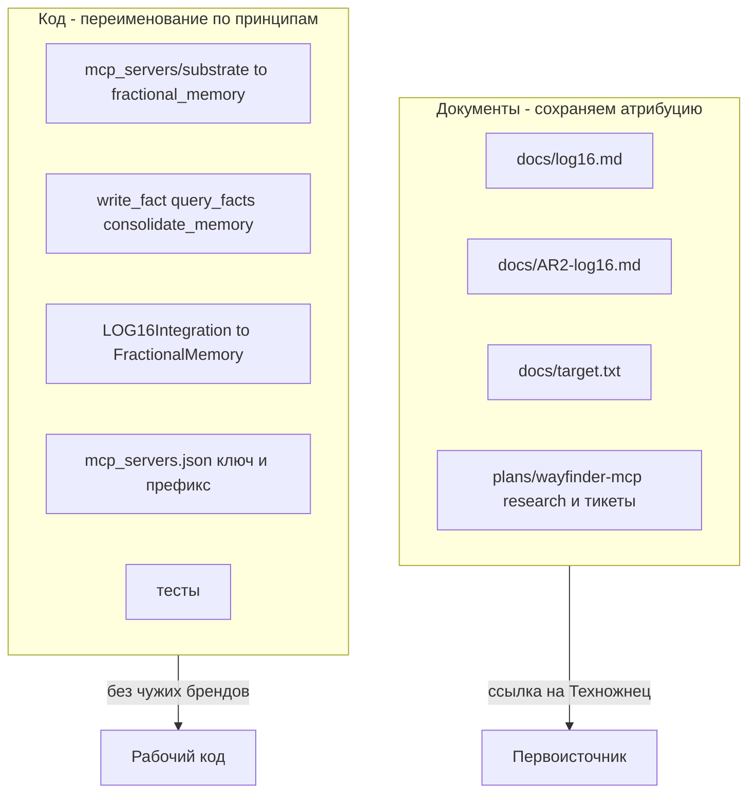

# План: удаление брендов LOG16 / Substrate из кода

## Цель

Оставить упоминания **LOG16** и **Substrate** только как ссылку на первоисточник
([Техножнец](https://t.me/technojnec)) в документах. В рабочем коде заменить их
на нейтральные имена, отражающие **принцип** реализации:

- **LOG16** → **Fractional Cache** — дробно-логарифмическая шкала полос (`band = floor(log16(age+1) - log16(access+1))`).
- **Substrate** → **Fractional Layered Memory** — слоистое хранилище фактов по полосам.

## Финальные имена

| Область | Старое | Новое |
|---|---|---|
| Каталог сервера | `mcp_servers/substrate/` | `mcp_servers/fractional_memory/` |
| Имя FastMCP | `"substrate"` | `"fractional_memory"` |
| Префикс MCP-инструментов | `substrate__` | `fractional_memory__` |
| Инструмент записи | `write_to_substrate` | `write_fact` |
| Инструмент поиска | `query_substrate` | `query_facts` |
| Инструмент GC | `equalize_memory` | `consolidate_memory` |
| MCP-ресурс | `substrate://status` | `memory://bands` |
| Мат-функция | `_log16()` | `_fractional_band()` |
| Класс интеграции | `LOG16Integration` | `FractionalMemory` |
| Модуль интеграции | `modules/log16_integration.py` | `modules/fractional_memory.py` |
| Конфиг-ключ | `"substrate"` | `"fractional_memory"` |
| Тест MCP | `tests/test_mcp_substrate.py` | `tests/test_mcp_fractional_memory.py` |
| Атрибуты/параметры | `self.log16`, `log16=` | `self.memory`, `memory=` |

## Границы: что НЕ трогаем

- `MemoryNode`, `frequency_band`, `gate_trigger` — нейтральны, остаются.
- Docstring-упоминания «субстрат/LOG16» → нейтральный текст «banded memory / band».
- [`docs/log16.md`](docs/log16.md), [`docs/AR2-log16.md`](docs/AR2-log16.md),
  [`docs/target.txt`](docs/target.txt), [`plans/wayfinder-mcp/`](plans/wayfinder-mcp/map.md) —
  **атрибуция первоисточника сохраняется без изменений**.

## Карта файлов

## Шаги реализации

1. **Артефакты.** Удалить устаревшие `.pyc` в каталоге сервера (`__init__.pyc`, `server.pyc`).
2. **Сервер.** `git mv mcp_servers/substrate mcp_servers/fractional_memory`;
   обновить модуль-пути внутри пакета.
3. **FastMCP.** В [`server.py`](mcp_servers/substrate/server.py:6) имя `fractional_memory`,
   `instructions` без брендов.
4. **Инструменты.** В [`tools.py`](mcp_servers/substrate/tools.py:23):
   `write_fact`, `query_facts`, `consolidate_memory`; ресурс `memory://bands`.
5. **Движок.** В [`helpers.py`](mcp_servers/substrate/helpers.py:19):
   `_log16` → `_fractional_band`, заголовки статуса и docstrings без субстрат/LOG16.
6. **Интеграция.** `git mv modules/log16_integration.py modules/fractional_memory.py`,
   класс `FractionalMemory`; префикс `fractional_memory__`.
7. **Реэкспорт.** [`migration_context.py`](modules/migration_context.py:11) — обновить импорт.
8. **Потребители.** [`migration_agent.py`](agents/migration_agent.py:22) и
   [`pipeline_executor.py`](agents/pipeline_executor.py:42) — `self.memory`, `memory=`.
9. **Конфиг.** [`mcp_servers.json`](mcp_servers.json:24) — ключ `fractional_memory`,
   описание, `args: ["-m", "mcp_servers.fractional_memory"]`.
10. **Корневые комментарии.** [`mcp_servers/__init__.py`](mcp_servers/__init__.py:10).
11. **Тесты.** `git mv tests/test_mcp_substrate.py tests/test_mcp_fractional_memory.py`;
    обновить [`test_migration_context.py`](tests/test_migration_context.py:14).
12. **Домен.** Дополнить [`CONTEXT.md`](CONTEXT.md:1) терминами
    `Fractional Cache`, `Fractional Layered Memory`, `Band`, `MemoryNode`; убрать бренды.
13. **ADR.** Зафиксировать решение о выносе брендов из кода.
14. **Проверка.** Тесты через `subprocess.run`, критерий `returncode == 0`;
    финальный grep: `substrate`/`log16` отсутствуют в `.py/.json`, присутствуют только в документах.