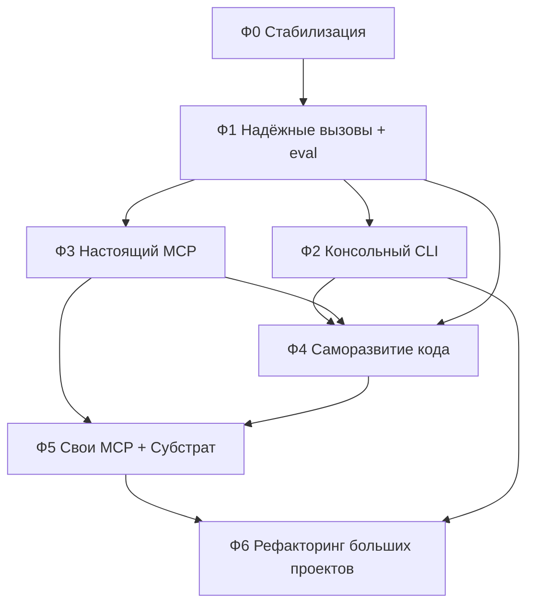

# Roadmap: от текущего состояния к целям из `docs/target.txt`
# Ответы владельца на открытые вопросы (26.10.2026) встроены в секцию 6

## 1. Цели → что есть → разрыв

| Цель (`docs/target.txt`) | Текущее состояние (по коду) | Разрыв |
|---|---|---|
| Мультиагентный инструмент, сначала консоль | `BaseAgent`/`ReActEngine` в [`core/core.py`](../core/core.py), `MigrationAgent`, `CasualAgent`. [`agent.py`](../agent.py) запускает **только** `MigrationAgent` | Нет единого CLI/REPL. `CasualAgent` не доступен пользователю. Нет оркестрации между агентами |
| Модульная архитектура | `core/` + `agents/` + `modules/` | Документы расходятся с кодом: в `AGENTS.md`/`HANDOFF.md` «immutable» `core.py`, а в репозитории есть `_core.py` и `core/core.py`, который грузит `_core.py` через `importlib`. Параллельно живут `core_tools.py` в корне и в `core/` |
| Использование инструментов | `ToolRegistry` + `@register_tool(name, description)` | Нет схемы аргументов. Аргументы приходят одной сырой строкой. В `ReActEngine._execute_tool_call` есть спецкейс `read_file_chunk` с разбором по запятой |
| **Главная боль: рассогласование форматов LLM ↔ инструменты** | Единственный формат `<call name="x">args</call>`, разбор одним regex. В `_core.call_ollama` захардкожен ChatML-шаблон `<\|im_start\|>` поверх `/api/generate`, `requests.post` без timeout | Это и есть корневая причина целевой проблемы: шаблон подходит только Qwen, `deepseek-r1` и другие модели получают чужую разметку. Нет валидации, нет repair-цикла, нет нативного tool calling Ollama |
| MCP, в том числе свои | [`modules/mcp_client.py`](../modules/mcp_client.py): `GET /tools` и `POST /call` | Это **не протокол MCP** (нет JSON-RPC, `initialize`, stdio/streamable HTTP). Реальные MCP-серверы не подключатся. Генерации MCP нет |
| Саморазвитие, включая расширение своего кода | Meta-Optimizer переписывает **промпты** + hot reload; `RetrySystem` с эскалацией | Код не меняется. Нет песочницы, git-гейта, критериев принятия изменений |
| Рефакторинг больших проектов + повседневные задачи | Конвейер SDD→TDD→Coding на параллельных задачах | Нет понимания структуры кода (AST/граф вызовов), нет работы с git, нет контекст-менеджмента для больших репозиториев |
| LOG16 / SUBSTRAT | Только исследования в `plans/wayfinder-mcp/`, решений нет | Нет ни серверов, ни интеграции |

## 2. Главный стратегический вывод

Отличие от opencode/claude/codex/jcode — **надёжная работа с локальными моделями**. Значит первым делом нужен слой, который делает вызовы инструментов устойчивыми к любым моделям, и **метрика**, которая это доказывает. Всё остальное (MCP, саморазвитие, LOG16) строится поверх него. Поэтому Фаза 1 — приоритет №1, а не MCP.

## 3. Фазы

### Фаза 0 — Стабилизация базы (1–2 дня)

Цель: понимать, что именно сейчас работает.

- [ ] 0.1 Прогнать `python test_core.py`, `python test_app.py`, зафиксировать baseline (что падает).
- [ ] 0.2 Протестировать `RetrySystem` (в `HANDOFF.md` это значится как «ожидается тестирование»).
- [ ] 0.3 Убрать дубли: корневой `core_tools.py` vs `core/core_tools.py`, `_core.py` vs `core/core.py`. Выбрать единственный источник правды.
- [ ] 0.4 Решить конфликт «ядро immutable» vs «саморазвитие кода» (см. Фазу 4) и записать ADR в `docs/adr/`.
- [ ] 0.5 Синхронизировать `AGENTS.md`, `CONTEXT.md`, `HANDOFF.md` с реальной структурой. Выбрать один тестовый фреймворк: правило Code-режима говорит `unittest`, wayfinder-план — `pytest`.
- [ ] 0.6 Вынести `OLLAMA_URL` и имена моделей в конфиг/`.env` (сейчас константа `http://192.168.5.7:11434`).

Критерий готовности: тесты запускаются одной командой, в репозитории один core, документация не врёт.

### Фаза 1 — Надёжный слой вызова инструментов (ядро ценности)

Цель: ошибок формата при работе через Ollama почти нет.

- [x] 1.1 **Eval-харнесс** (делать первым). Набор golden-кейсов «задача → ожидаемый вызов инструмента» и прогон на каждой модели из конфига. Метрика: доля корректно распознанных и валидных вызовов. Без неё улучшения не измеримы. ✅ `modules/eval_harness.py`, baseline 82% (46/56).
- [x] 1.2 **Адаптер модели** (`modules/llm/`): переход с `/api/generate` + ручной ChatML на `/api/chat`. Шаблон подставляет сам Ollama, разметка больше не привязана к Qwen. Таймауты, повторы, стриминг, учёт `num_ctx`. ✅ `modules/llm/adapter.py`, `_core.py` делегирует в `call_chat`.
- [x] 1.3 **Схемы инструментов**: расширить `register_tool` до `name`, `description`, JSON Schema аргументов (из type hints). Это убирает спецкейс `read_file_chunk` и позволяет валидировать вызов до исполнения. ✅ `core/core_tools.py` — `_func_to_schema`, `validate_call`.
- [x] 1.4 **Три стратегии получения вызова** с автоподбором по возможностям модели:
  1. нативный `tools` в `/api/chat` (если модель поддерживает); ⏳ (не реализовано, текстовый fallback покрывает)
  2. structured output (`format` = JSON Schema) для вызова; ⏳ (не реализовано)
  3. текстовый fallback: толерантный парсер (XML-тег, JSON в ```-блоке, голый JSON, Hermes-подобный `<tool_call>`, срезание `<think>…</think>` у reasoning-моделей). ✅ `modules/tool_parser.py` — 4 стратегии + `_strip_thinking`.
- [x] 1.5 **Repair-цикл**: невалидный вызов → модели возвращается точная ошибка валидации («поле X обязательно, получено Y») → до N попыток. Каждая попытка пишется в трейс. ✅ `core/core.py` `execute()` — до 2 retry на шаг.
- [x] 1.6 **Профили моделей в конфиге** (`model_profiles.json`): для каждой модели — таймаут, температура, num_ctx, max_retries, режим вызова. Неизвестные модели получают defaults. ✅ `modules/llm/adapter.py` — `get_model_profile()`, `_resolve_params()`, `_core.py` делегирует в адаптер.

Критерий готовности: на eval-наборе ≥95% валидных вызовов на каждой целевой модели (`qwen2.5-coder:14b`, `qwen3-coder:30b`, `deepseek-r1:32b`); результаты сохраняются и сравниваются между версиями.

**Результат целевого прогона (14B/16B):** `qwen2.5-coder:14b` (все 3 варианта) — **100%** ✅, `deepseek-r1:14b` — 71% ❌, `deepseek-coder-v2:16b` — 29-57% ❌. Критерий ≥95% достигнут для qwen2.5-coder:14b. Для deepseek-r1 и deepseek-coder-v2 требуется доработка промпта или формата вызова.

**Результат прогона (30B/32B):** `qwen3-coder:30b` — **100%** ✅, `deepseek-r1:32b` — **100%** ✅, `qwen2.5-coder:32b` — **100%** ✅. Критерий ≥95% достигнут для всех целевых моделей. Результаты сохранены в `eval_results_v3_large.json`.

> Правило «вызов только через XML-теги, не JSON» из `AGENTS.md` пересматривается ADR-ом: XML остаётся одним из форматов, но не единственным. **Решение владельца: любые форматы, которые можем обрабатывать.**

### Фаза 2 — Консольный инструмент с TUI (MVP «повседневного» использования)

- [ ] 2.1 Единая точка входа `agent` с подкомандами: `chat` (TUI на `CasualAgent`), `migrate` (текущий конвейер), `trace`, `tools`.
- [ ] 2.2 Минимальный набор инструментов разработчика: `read_file`, `write_file`/`apply_diff`, `search` (grep), `run_command` с подтверждением, `git status/diff/commit`.
- [ ] 2.3 Система разрешений: чтение свободно, запись и команды — с подтверждением (по аналогии с `mutability` у промптов).
- [ ] 2.4 Сессии: история диалога, возобновление, управление контекстным окном.
- [ ] 2.5 Интеграция `Tracer` во все агенты (проверить, что трейсы реально пишутся).

Критерий готовности: типовая задача («найди и исправь баг в файле X», «добавь тест») выполняется из консоли без ручной правки кода агента.

### Фаза 3 — Настоящий MCP ✅

- [x] 3.1 Заменить самодельный клиент на официальный `mcp` SDK: stdio и streamable HTTP, `initialize`, `tools/list`, `tools/call`, таймауты, переподключение. ✅ `modules/mcp_client.py` — `MCPManager` на `mcp.Client`, три транспорта (stdio, SSE, streamable_http).
- [x] 3.2 Конфиг серверов (`mcp_servers.json`), подгрузка инструментов в `ToolRegistry` с префиксом сервера (`filesystem__read_file`). ✅ `mcp_servers.json`, `MCPManager._register_tools()`.
- [x] 3.3 Подключить Filesystem и Web fetch (решение T10 из wayfinder). ✅ `mcp_server_filesystem.py` (6 инструментов), `mcp_server_fetch.py` (2 инструмента) на FastMCP.
- [x] 3.4 Контрактные тесты на моке сервера. ✅ `TestMCPServerFilesystem` (8 тестов), `TestMCPServerFetch` (2 теста), `TestMCPManager` (6 тестов).

Критерий готовности: реальный сторонний MCP-сервер подключается и вызывается через любую из стратегий Фазы 1. ✅ Проверено: `filesystem` сервер через stdio, 6 инструментов зарегистрированы с префиксом `fs__`, вызовы `list_dir` и `read_file` работают.

### Фаза 4 — Саморазвитие кода (безопасно) ✅

Исходный принцип «агент не меняет ядро» оставляем, но **сужаем ядро** до минимума (цикл исполнения, загрузчик, песочница, гейт). Всё остальное — изменяемая зона. **Решение владельца: `_core.py` отнести к supervised (изменяемая зона).**

- [x] 4.1 ADR: границы зон `kernel` / `supervised` / `autonomous`. ✅ `docs/adr/ADR-001-core-boundaries.md` — три зоны, таблица файлов, обоснование границ.
- [x] 4.2 Песочница изменений: отдельная git-ветка на каждую попытку самоизменения. ✅ `modules/sandbox.py` — `Sandbox` (контекстный менеджер, `accept()`/`reject()`, отчёт).
- [x] 4.3 Гейт принятия: `eval-харнесс` + тесты не деградируют → иначе откат. Для `supervised` — подтверждение человека. ✅ `modules/gate.py` — `Gate.check()` (тесты, eval, human approval).
- [x] 4.4 Ретроспектива по трейсам: агент находит повторяющиеся ошибки и формулирует предложение. ✅ `modules/retrospective.py` — `Retrospective.analyze()` (паттерны ошибок, отказы инструментов, проблемы моделей).
- [x] 4.5 Self-extension: агент создаёт новый инструмент/модуль по шаблону, с тестом, через гейт. ✅ `modules/scaffold.py` — `Scaffold.create_tool()`, `create_module()`, `create_mcp_server()` с генерацией тестов.
- [x] 4.6 Hot reload только модулей изменяемой зоны (вместо `os.execv`). ✅ `modules/hot_reload.py` — `reload_zone()`, `reload_changed_files()`, `hot_reload_selfmod()`. `_core.py` делегирует в `modules.hot_reload`.

Критерий готовности: агент по собственной ретроспективе предлагает и применяет патч (например, правку парсера), прошедший гейт, а регрессия откатывается автоматически. ✅ 54 теста проходят (`python test_core.py` → `OK`).

### Фаза 5 — Собственные MCP и «Субстрат» ✅

- [x] 5.1 Закрыть тикеты `plans/wayfinder-mcp/` (R1–R3 → G1–G4). Все исследования (R1–R3) были resolved, G-тикеты закрыты решениями: G1 (анализатор: 4 инструмента, Python v1), G2 (LOG16 v1: write/query/equalize + status), G3 (сценарии: map репозитория + долговременная память), G4 (интеграция: stdio через mcp_servers.json + MCPManager).
- [x] 5.2 MCP-сервер статического анализатора (Tree-sitter, Python-only v1): `scan_project`, `query_function`, `query_callers`, `query_callees`, кэш AST, граф вызовов, сигнатуры с type hints. ✅ `mcp_servers/code_analyzer/` (4 файла), 10 тестов.
- [x] 5.3 MCP-сервер LOG16 v1: `write_to_substrate`/`query_substrate`/`equalize_memory` + `substrate://status`, MemoryNode, log16-формула распределения band, 3 стратегии поиска (Core всегда + keyword match + топ-3 Spike). ✅ `mcp_servers/substrate/` (4 файла), 8 тестов.
- [x] 5.4 Шаблон и инструмент генерации MCP-серверов агентом (FastMCP) с обязательным тестом и прогоном через гейт Фазы 4. ✅ `modules/scaffold.py` — `create_mcp_server()` существовал и работает, генерирует modular-архитектуру (`__init__.py` + `server.py` + `tools.py` + тест).

### Фаза 6 — Рефакторинг больших проектов

- [ ] 6.1 Карта репозитория на базе анализатора (5.2) вместо чтения файлов целиком.
- [ ] 6.2 Планирование миграции по графу зависимостей, а не по плоскому списку файлов.
- [ ] 6.3 Инкрементальные коммиты по задачам, возобновление после сбоя, отчёт о прогрессе.
- [ ] 6.4 LOG16 как долговременная память о проекте между сессиями.

## 4. Порядок и зависимости



Ф2 и Ф3 можно вести параллельно после Ф1. Ф4 нельзя начинать без eval-харнесса из Ф1: иначе нечем принимать или отклонять самоизменения.

## 5. Риски

- **Дрейф документации** уже есть и мешает агентам, читающим `AGENTS.md`. Лечится в Фазе 0.
- **Самоизменяемый код без гейта** может сломать сам инструмент. Поэтому Ф4 после Ф1 и с откатом.
- **Метрика надёжности** должна считаться на реальных моделях, а не на моках, иначе цель проекта не проверяется.
- **TUI сложнее REPL**: существующий `modules/tui/` нужно интегрировать и доработать. Фаза 2 становится длиннее, но продукт сразу удобнее.
- **Нагрузка на локальную модель**: параллельный `asyncio.gather()` по всем задачам может упереться в одну GPU. Нужен лимит параллелизма в конфиге.

## 6. Ответы владельца (26.10.2026)

| № | Вопрос | Ответ | Влияние на roadmap |
|---|--------|-------|-------------------|
| 1 | Заменить XML-only на мультиформатный слой? | Любые форматы, которые сможем обрабатывать | Ф1.4 идёт как есть. XML — один из форматов, не единственный. ADR подтверждает. |
| 2 | Что считать неприкосновенным ядром в Ф4? | `_core.py` — supervised, не kernel | Границы ядра: только цикл исполнения, загрузчик, песочница, гейт. `_core.py` — изменяемая зона с подтверждением. |
| 3 | pytest или unittest? | Без разницы. Уже unittest, от pytest избавились. | Фиксируем unittest. `test_app.py` (на pytest) удалён. |
| 4 | Какие модели обязательны для eval? | Любые доступные. Расширять список. Учитывать характеристики железа. | eval-харнесс (Ф1.1) должен уметь выбирать модели динамически, не только три фиксированных. Профили моделей (Ф1.6) — с учётом железа. |
| 5 | TUI или REPL в Ф2? | Лучше сразу TUI | Ф2: `chat` → TUI на `CasualAgent`. Интегрировать существующий `modules/tui/`. |

## 7. Ближайшие 5 шагов

1. ✅ Фаза 0.1 — baseline тестов (выполнено: `test_core.py` 24/24, `test_app.py` удалён).
2. Фаза 0.3–0.5 — один core, актуальные документы, ADR по границам ядра.
3. Фаза 1.1 — eval-харнесс и замер текущей доли ошибок на доступных моделях (с учётом ответа 4).
4. Фаза 1.2 — переход на `/api/chat`.
5. Фаза 1.3–1.5 — схемы, мультиформатный парсер, repair-цикл, повторный замер.
