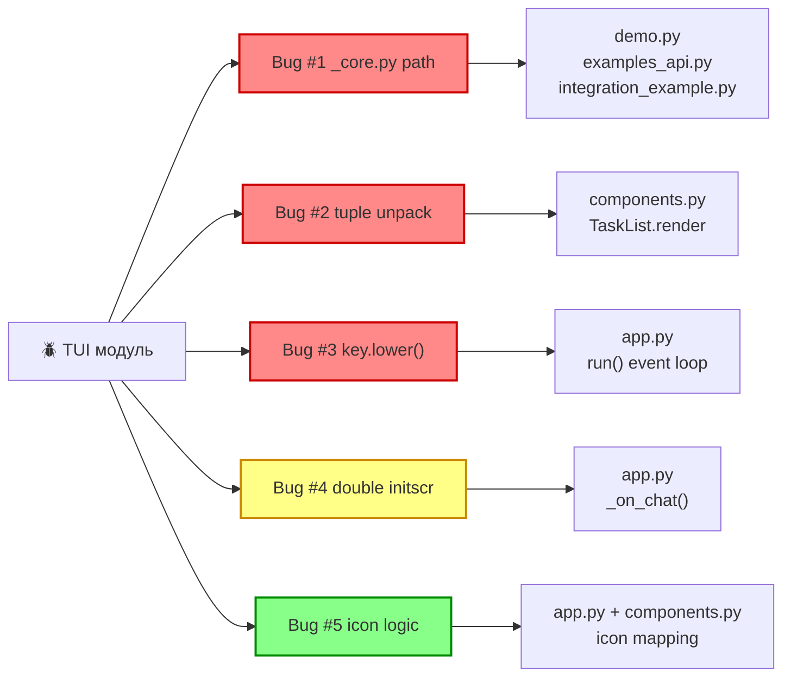

# План исправления багов TUI модуля

## Диагноз: 5 багов

### Bug #1 — 🔴 CRITICAL: Неправильный путь к `_core.py`

**Файлы:** [`modules/tui/demo.py:9`](../modules/tui/demo.py:9), [`modules/tui/examples_api.py:11`](../modules/tui/examples_api.py:11), [`modules/tui/integration_example.py:11`](../modules/tui/integration_example.py:11)

**Проблема:** Используется `os.path.dirname(os.path.dirname(...))` что даёт путь `/home/giv/www/ai-agent/modules/`, а `_core.py` лежит в корне `/home/giv/www/ai-agent/_core.py`. Нужно подняться на **3 уровня** вверх от `modules/tui/` а не на 2.

**Исправление:** Заменить на `os.path.dirname(os.path.dirname(os.path.dirname(...)))` во всех трёх файлах.

---

### Bug #2 — 🔴 CRITICAL: Ошибка распаковки кортежей в `TaskList.render()`

**Файл:** [`modules/tui/components.py:60-66`](../modules/tui/components.py:60-66)

**Проблема:** Структура данных содержит лишнюю запятую. Вместо списка кортежей `[(icon, list), (icon, list), ...]` написан список из **одноэлементных кортежей**, каждый из которых содержит вложенный кортеж `((icon, list),)`. При распаковке `for status_icon, tasks_list in ...` Python пытается распаковать один элемент в две переменных → `ValueError: too many values to unpack`.

```python
# ТЕКУЩИЙ КОД (ОШИБКА):
for status_icon, tasks_list in [
    (("[yellow]⏳[/yellow]", by_status["pending"]),),  # ← лишняя запятая
    (("[bold green]▶️[/bold green]", by_status["running"]),),  # ← лишняя запятая
]:
    if tasks_list:  # tasks_list — это tuple (icon, list), всегда truthy!
```

**Исправление:** Убрать лишние запятые и внешние скобки:

```python
for status_icon, tasks_list in [
    ("[yellow]⏳[/yellow]", by_status["pending"]),
    ("[bold green]▶️[/bold green]", by_status["running"]),
    ("[green]✅[/green]", by_status["completed"]),
    ("[red]❌[/red]", by_status["failed"]),
    ("[orange]🔄[/orange]", by_status["retrying"]),
]:
    if tasks_list:
        ...
```

---

### Bug #3 — 🔴 CRITICAL: `key.lower()` на `int` в обработчике нажатий

**Файл:** [`modules/tui/app.py:71`](../modules/tui/app.py:71)

**Проблема:** `stdscr.getch()` возвращает `int`, а в коде вызывается `key.lower()`. Это вызовет `AttributeError: 'int' object has no attribute 'lower'` при любой нажатой клавише.

```python
key = stdscr.getch()  # getch() возвращает int!
action, description = self.HOTKEYS.get(key.lower())  # ❌ int.lower() не существует
```

**Исправление:** Заменить на `chr(key).lower()`:

```python
action, description = self.HOTKEYS.get(chr(key).lower())
```

Также нужна обработка `KeyError`/`ValueError` от `chr()` для значений `key` вне ASCII-диапазона.

---

### Bug #4 — 🟡 WARNING: Двойной вызов `curses.initscr()` в `_on_chat()`

**Файл:** [`modules/tui/app.py:60, 183`](../modules/tui/app.py:60)

**Проблема:** `run()` уже вызывает `curses.initscr()` на строке 60, сохраняя `stdscr`. Но `_on_chat()` на строке 183 вызывает `curses.initscr()` повторно. Это нарушает работу curses (каждый initscr должен быть парным с endwin).

**Исправление:** Сохранять `stdscr` как атрибут класса `self.stdscr` в `run()` и использовать его в `_on_chat()`, либо передавать через аргумент.

---

### Bug #5 — 🟢 LOW: Неправильная логика иконок в `FileExplorer`

**Файлы:** [`modules/tui/components.py:128-131`](../modules/tui/components.py:128-131), [`modules/tui/app.py:116-119`](../modules/tui/app.py:116-119)

**Проблема:** Логика выбора иконки излишне запутанная, дублированная (в 2 местах). Тройной тернарный оператор с условием `not endswith(...)` трудночитаем:

```python
icon = "[yellow]📄[/yellow]" if not f_name.endswith((".py", ".json")) else \
       "[blue]📝[/blue]" if f_name.endswith(".py") else "[magenta]⚙️[/magenta]"
```

Работает корректно, но:
1. Дублируется в `components.py` и `app.py`
2. Сложная вложенная тернарная логика
3. Нужно вынести в отдельную функцию для DRY

**Исправление:** Создать функцию-утилиту и переиспользовать её.

---

## Диаграмма исправлений



## Порядок исправления

1. **Bug #1** — критический блокер запуска; исправить путь в 3 файлах
2. **Bug #2** — критический блокер рендеринга `component.py: TaskList`
3. **Bug #3** — критический блокер event loop в `app.py`
4. **Bug #4** — предупреждение; некритично для demo.py (без curses), но критично для app.run()
5. **Bug #5** — низкий приоритет; рефакторинг читаемости

## Проверка

```bash
python modules/tui/demo.py --mode full
python modules/tui/demo.py --mode simple
python modules/tui/demo.py --mode events